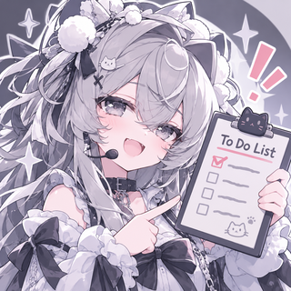

<p align="center"></p>

# dsh-sidebar-memo

右侧边栏的「备忘录」：一张和模型共写的待办清单，加上按天分页的日记。它注册进 DSH 自带的右侧边栏首页，和「工作区文件」「新建终端」「浏览器」共用同一套胶囊按钮、图标位和选中动画，排在它们下面。

## 功能

**待办**。一条待办可以是只有一行标题的小事，也可以带一整段备注和一组步骤：

- 标题一行，长标题自然折行。
- 备注放长内容。`学院：…`、`条件：…`、`材料：…` 这类行会自动识别成键值排成两列；折叠时副行显示这些键本身，一眼看得出这条里有什么。
- 步骤是一列可勾选的小项，副行显示进度。
- 旧数据不需要整理：第一行当标题、其余进备注，加载时自动升级。

**日记**。一天一页 Markdown，自动保存，⌘S 立即保存；点日期文字弹出日历，可以跳到任意一天；日期条自动跟随当前页；底部显示字数。

**模型共写**。两个工具读写同一份数据。模型改动时面板会播放对应动画：新条目从下方淡入、勾选时描边、删除时收拢、写日记时左侧装订线亮一下；标题行用一句话说明刚发生了什么，三秒后自己退场。

**上传**。可以把整本日记上传到 note.ms 或 getnote.top 的指定记事本。上传是唯一的联网出口，只有你在面板上按下按钮并二次确认才会发生；没有给模型留上传工具。

## 安装

把下面这段发给你的 AI 助手，让它替你装：

```text
把 https://github.com/Alamanes/dsh-sidebar-memo 装进我的 DSH profile：
1. 在 ~/.dsh/profiles/<profile>/package.json 的 dependencies 里加入
   "dsh-sidebar-memo": "github:Alamanes/dsh-sidebar-memo"
2. 把 "dsh-sidebar-memo" 加进同文件的 dsh.profile.bundles 列表
3. 在 profile 目录执行 pnpm install
4. 重启 DSH
```

本地开发时用 `link:` 代替 `github:`，改源码立即生效；前端那一半改动要重启 DSH 才会重新加载。

## 数据

全部在本地，不上传（除非你点上传）：

| 文件 | 内容 |
| --- | --- |
| `~/.dsh/storages/dsh-memo/todos.json` | 待办清单 |
| `~/.dsh/storages/dsh-memo/diary/YYYY-MM-DD.md` | 每天的日记 |
| `~/.dsh/storages/dsh-memo/settings.json` | 上传目标（服务商与记事本 ID） |

目录可以用插件配置项的 `dataDir` 改。

## 工具

| 工具 | 参数 | 说明 |
| --- | --- | --- |
| `memo` | `op`（read/add/done/del/clear）、`text`、`note`、`steps`、`id` | 读或改待办 |
| `diary` | `op`（read/write）、`date`、`text`、`mode` | 读或写某一天的日记 |

两个工具的 schema 都刻意做小：常在上下文里的东西，多一个属性就多一分开销。

## 项目结构

```text
src/index.js         宿主半边：提示段、两个工具、面板路由
src/host/store.js    待办 / 日记 / 设置的文件存储与结构迁移
src/host/tools.js    memo 与 diary 两个工具
src/host/notebook.js 唯一的联网出口：往在线记事本写一整本日记
lib/client.js        浏览器半边：右侧边栏标签类型与面板
lib/memo.css         面板样式，由 api/dsh-memo/style 提供给浏览器
lib/avatar.png       胶囊与标签页上的圆形标记
icon.png             插件列表里的图标
```

## 卸载

从 profile 的 `dsh.profile.bundles` 里删掉 `dsh-sidebar-memo`，再从 dependencies 删掉这一行，然后 `pnpm install` 并重启。数据目录会留着，要清掉就手动删 `~/.dsh/storages/dsh-memo`。

## 排错

| 现象 | 检查 |
| --- | --- |
| 首页没有「备忘录」 | 重启宿主后在控制台看 `dsh-sidebar-memo` 前缀的报错；确认依赖和 bundles 都写了 |
| 面板空白 | `api/dsh-memo/state` 是否 200，数据目录是否可写 |
| 没有样式 | `api/dsh-memo/style` 是否返回 CSS，`lib/memo.css` 是否在包里 |
| 图标不显示 | `api/dsh-memo/avatar` 是否返回图片；`icon.png` 需小于 256 KiB |
| 上传失败 | 服务商与记事本 ID 是否填对，note.ms / getnote.top 是否可直连 |

## 许可

MIT
